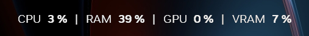

# perf-overlay

A tiny always-on-top overlay for Windows that shows CPU, RAM, GPU and VRAM usage at the top of the screen. It copies the look of the NVIDIA App statistics overlay (Alt+R) and adds the two numbers that overlay lacks: system RAM and VRAM.



- One line, centered at the top of the primary monitor, refreshed every second
- **Alt+R** shows/hides it
- Clicks go through it, no taskbar entry, only one instance runs at a time
- ~170 KB executable, ~8 MB of RAM, ~0.1% of one CPU core while visible, nothing while hidden
- Works with any GPU vendor, no admin rights needed

## Where the numbers come from

| Metric | Source |
|---|---|
| CPU | `GetSystemTimes`, delta between refreshes |
| RAM | `GlobalMemoryStatusEx` memory load (Task Manager's "in use") |
| GPU | `\GPU Engine(*)\Utilization Percentage` counters: utilization summed over processes per engine, busiest engine wins (the Task Manager method) |
| VRAM | `\GPU Adapter Memory(*)\Dedicated Usage` divided by the adapter's dedicated memory from the display driver registry key |

## Font

The overlay uses **NVIDIA Sans**, the font of the NVIDIA overlay. The font is not included here because it is not redistributable. At startup the program looks for `NVIDIASans_Rg.ttf` and `NVIDIASans_Bd.ttf` next to the executable, then in `%ProgramFiles%\NVIDIA Corporation\Installer2\*`, where the NVIDIA driver installer puts them. If it finds neither, it falls back to Segoe UI.

## Download

Grab `perf-overlay.exe` from the [latest release](https://github.com/LeandroLP23/perf-overlay/releases/latest) (Windows 10/11 x64), or build it yourself.

## Build

Requires Rust with the MSVC toolchain.

```
cargo build --release
```

The executable is `target\release\perf-overlay.exe`.

## Install

Copy `perf-overlay.exe` anywhere, then register it to start at logon (hidden until Alt+R):

```
reg add HKCU\Software\Microsoft\Windows\CurrentVersion\Run /v PerfOverlay /d "\"C:\path\to\perf-overlay.exe\"" /f
```

- Start it visible right away: `perf-overlay.exe --show`
- Stop it: `taskkill /im perf-overlay.exe`
- Remove autostart: `reg delete HKCU\Software\Microsoft\Windows\CurrentVersion\Run /v PerfOverlay /f`

Colors, font size, spacing and refresh rate are constants at the top of `src/main.rs`.

## Limitations

- **Exclusive fullscreen games cover it.** It is a normal topmost window, and nothing can draw over a game running in exclusive fullscreen. The NVIDIA overlay gets around this by drawing inside the game's own frames. Run games in borderless mode instead, which on Windows 10/11 performs the same.
- **Alt+R clashes with the NVIDIA overlay**, which uses the same shortcut. Turn that overlay off or change its shortcut in the NVIDIA App. If Alt+R is already registered by another program, perf-overlay says so and stays always visible.
- Primary monitor only. DPI is read once at startup.

Not affiliated with or endorsed by NVIDIA.
